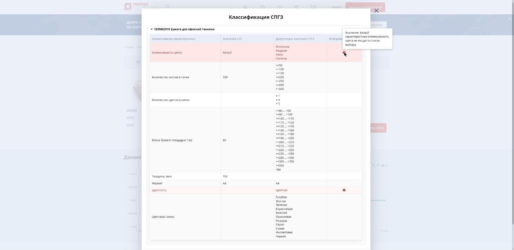

# Портал поставщиков глазами: где болит автозаполнение СТЕ

Смотрели 30.09.2026 в Chrome без входа в аккаунт: публичные страницы zakupki.mos.ru и публичный JSON-API, которым
пользуется сам сайт. Вывод: портал уже хранит всё, что нужно для кейса (характеристики, допустимые значения,
признаки «определяет уровень»), но заполнение и подбор классификаторов работают по названию, а не по
характеристикам, и конфликты только подсвечиваются, а не решаются.

## 1. Как устроена карточка СТЕ

- Адрес: `/sku/view/{id}`, вкладки «Общие сведения», «Предложения», «Характеристики», «Доп. сведения».
- Хлебные крошки — путь КПГЗ: Товары › Изделия канцелярские, бумага и бумажные изделия › Бумага › Бумага для
  канцелярских нужд › Бумага для офисной техники.
- «Доп. сведения»: ОКПД2, КПГЗ, СПГЗ (может быть пусто, рядом кнопка «Подобрать СПГЗ»).
- «Характеристики»: переключатель «Все характеристики» / «Характеристики справочника госзаказа».
- JSON карточки: `GET /classifier/api/Sku/GetSku?id=<id>&withRegionPriceStatistics=false`, пример —
  [sku-47453345.json](sku-47453345.json). Полезные поля:
  - `name`, `description` (свободный текст), `modelName`, `manufacturerName`;
  - `okeiName` / `okeiShortName` — единица СТЕ, `oksm*` — страна;
  - `productionDirectory` — узел КПГЗ (`isLastLevel`, `treePathId`), `production.okpd` — ОКПД2;
  - `ktru`, `spgzId` — ссылки на КТРУ и СПГЗ (в примере обе `null`);
  - `creationSourceName` — «Создание СТЕ через заявку»;
  - `skuCharacteristics[]`: описание характеристики (`productCharacteristicName`, тип «Справочник» или «Дробное
    числовое значение», единица, `isRange`, `isObligatory`, **`isLevelDefine` / `isParentLevelDefine`**,
    `ktruValues`, `spgzValues`, `productCharacteristicSynonyms`, `valueRangeConditions`) и само значение
    (`characteristicValueStringValue`, `characteristicValueDecimalValue` и т.д.).
- Каталог уже фильтрует по характеристикам: в URL поиска есть `characteristicName`, `characteristicValue`,
  `okpdPaths`, `productionDirectoryPaths`. Унифицированные значения сразу улучшают фильтры и поиск.
- Масштаб каталога (карусель на `/catalog/goods`): «Есть предложения» — 118 114 СТЕ, «Произведено в Москве» —
  24 946, «Инновационная продукция» — 1 515.

## 2. Живая карточка: СТЕ 47453345 «Бумага офисная Туринский ЦБЗ А4 500л»

Описание поставщика против структурированных характеристик:

| Строка из `description` | Что попало в характеристики |
|---|---|
| Масса бумага площадью 1 м2, г 80 | «Масса бумаги площадью 1м2» = 80 г |
| Толщина, мкм 104 | «Толщина, мкм» = 104 (единица только в названии) |
| Белизна с ООВ по ISO, % 98 | **нет** |
| Непрозрачность, % 90 | **нет** |
| Размер листа. мм А4 210*297 | «Формат» = А4 |
| Предельные отклонения по косине листа, мм 0,5 | **нет** |
| Количество листов в пачке А4 500 | «Количество листов в пачке» = 500 шт |
| Количество пачек в коробке 5 шт. | **нет** |
| (в описании этого нет) | «Интенсивность цвета» = **Белый** — такого значения у характеристики нет |

Что не так:

1. Четыре из восьми характеристик описания не попали в структуру, хотя в тексте они есть.
2. Значение, которого нет в справочнике: «Интенсивность цвета: Белый» (допустимы Интенсив, Медиум, Неон, Пастель).
3. Единицы живут где попало: в значении («80 г», «500 шт»), в названии («Толщина, мкм»); у плотности бумаги
   единица «г» вместо г/м².
4. Опечатки в описании: «Масса бумага», «Размер листа. мм».
5. Нет ни КТРУ, ни СПГЗ.
6. Единица СТЕ — «Штука», в названии «500л», в описании «5 шт.» пачек в коробке, цена 1 850 ₽ за «штуку». Что
   такое «штука» — пачка или коробка — из карточки не понять. У похожей СТЕ «Бумага писчая УралРегионБумага А4,
   500 листов» единица — «Пачка». Одинаковый товар в разных единицах ломает сравнение цен.

## 3. Штатный «Подобрать СПГЗ» ошибается и не объясняет

Кнопка подобрала СПГЗ 1599802915 «Бумага для офисной техники». Допустимые значения этой позиции:
«Интенсивность цвета» — Интенсив / Медиум / Неон / Пастель, «Цветность» — Цветная, «Цветовая гамма» — Голубая …
Черная. То есть это позиция **для цветной бумаги**, а товар — белая бумага (белизна 98% в описании).

Портал сам подсвечивает конфликт красным. Подсказка: «Значение 'Белый' характеристики Интенсивность цвета не входит
в список выбора». «Цветность» пустая при единственном допустимом «Цветная». Но дальше ничего: нет альтернативных
позиций, нет объяснения, нет шагов. Подбор идёт по категории или названию, характеристики в нём не участвуют.
Это ровно задачи Т2.4, Т2.5 и Т3 нашего кейса.

Официальная «Инструкция по созданию оферты и СТЕ» (04.06.2026) это подтверждает: «Подобрать СПГЗ» ищет только
точное совпадение характеристик, а в упрощённой форме характеристики заполняет модератор. Правила модерации и
остальные выдержки — в [tenderhack-patterns.md](tenderhack-patterns.md#7-официальные-правила-создания-и-модерации-сте).

Ещё одна деталь с того же экрана: допустимые значения числовых характеристик — корзины и пороги. У плотности это
«>=80 … <90», «>=90 … <100» и так далее, у количества листов — «>=50» … «>=500». В СТЕ хранится точка (80),
её нужно отображать в корзину.

## 4. Поиск по каталогу

- «бумага офисная А4» — в подсказках рядом с бумагой «Файл-вкладыш ОФИСНАЯ ПЛАНЕТА А4 30мкм» (совпали слова
  «офисная» и «А4»).
- «бумага афисная А4» (опечатка) — офисная бумага из подсказок пропадает: «Магнитная бумага (винил) А4»,
  «Бумага писчая … 500 листов», «Бумага цветная А4». Опечатки не исправляются.

## 5. Что из этого берём в решение

1. Извлекать из описания **все** характеристики, а не только введённые руками. LLM с JSON-схемой характеристик
   позиции плюс регулярки для чисел и единиц. У каждого значения — ссылка на кусок текста, из которого оно взято.
2. Выбирать КТРУ и СПГЗ по характеристикам, а не по названию. Кандидаты берём гибридным поиском, потом
   проверяем совместимость каждого значения с допустимыми. Белая против цветной решается «Цветностью» или
   «Белизной».
3. Показывать конфликт вместе с выходом: «для белой бумаги подходит позиция X, текущая Y — для цветной,
   противоречат 2 характеристики».
4. Единицы — к ОКЕИ и в одно место (значение + единица), точечные значения — в допустимые корзины.
5. Проверять согласованность единицы и фасовки: штука, пачка или коробка против названия и описания.
6. Проверка перед отправкой заявки на модерацию. В базе знаний есть статьи «Какой срок рассмотрения заявок на
   создание новой позиции СТЕ…» и «Как ускорить срок рассмотрения заявки…»; по отзывам модерация идёт до 5 рабочих
   дней. Автопроверка по официальным правилам модерации до отправки — меньше возвратов и быстрее модерация.
7. Масштаб: 3,5 млн СТЕ и около 2 тыс. новых в день (m24.ru, 20.05.2026). Ручная модерация характеристик на таком
   потоке — прямой аргумент за автоматизацию.

## Источники

- Карточка: https://zakupki.mos.ru/sku/view/47453345 (30.09.2026)
- JSON: https://zakupki.mos.ru/classifier/api/Sku/GetSku?id=47453345&withRegionPriceStatistics=false →
  [sku-47453345.json](sku-47453345.json)
- Каталог: https://zakupki.mos.ru/catalog/goods; база знаний: https://zakupki.mos.ru/knowledgebase/main/supplier
